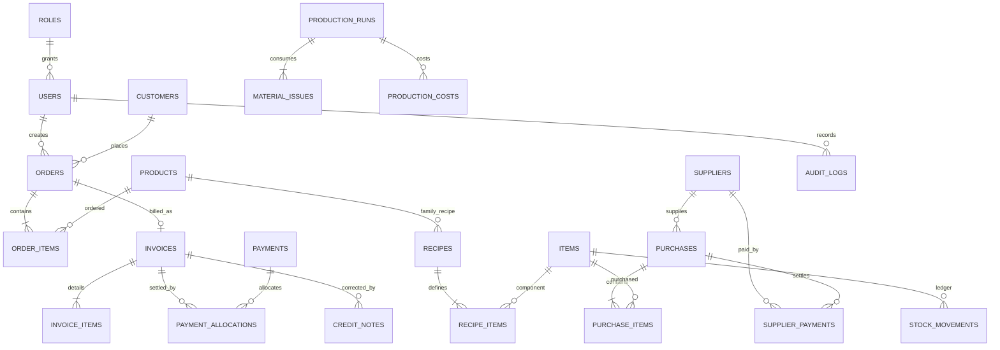

# SnackFlow ERP — Design Note

## 1. Data model

`items` is the inventory identity table. Its `item_type` is `raw`, `packaging` or `finished`; its base unit is `g`, `ml`, `piece` or `packet`. `products` adds product-family and pack-size attributes. Recipes are resolved by family, so multiple pack sizes can share a recipe. These enumerations, together with order status and GST type, are enforced by database `CHECK` constraints on PostgreSQL and on any schema created from the models.

`supplier_payments` completes the payable side: a payment may be allocated to a purchase bill (over-payment rejected against the bill outstanding) or left on account. Payables are derived as `SUM(purchases.total) - SUM(supplier_payments.amount)` per supplier; no stored balance can drift.

## 2. Stock ledger and BOM calculation

Stock is not a mutable field. `stock_movements.quantity` is signed and stored in the item's base unit. Opening balances and purchases are positive; production material issues and dispatches are negative; production output is positive. The balance is `SUM(quantity)` for an item. Every movement stores a source document type and ID, actor, timestamp, unit cost and extended value.

For the benchmark, flour opening stock is 100,000 g at ₹0.042/g. The 60 kg receipt is 60,000 g at ₹0.045/g. Weighted-average rate becomes `(100000×0.042 + 60000×0.045) / 160000 = ₹0.043125/g`, i.e. ₹43.125/kg. Issuing 40,000 g costs ₹1,725.

The BOM is stored in base units per one full batch: 40,000 g flour, 10,000 ml oil, 1,200 g spice, 200 pouches and 10 cartons. Actual issues are 40,000 g, 10,500 ml, 1,200 g, 194 pouches (188 good + 6 damaged), and 9 cartons. Variance is `(actual - planned) / planned × 100`. The tolerance is strictly greater than 3%: oil +5% and cartons -10% are flagged; pouch -3% is displayed but not flagged. Yield variance is `(188 - 200) / 200 = -6%`.

The carton capacity check compares `cartons_used × conversion_factor` (20 packets per carton in the benchmark) with actual good packets. Nine cartons represent capacity for 180 packets, so the 188-packet output is flagged without altering the recorded carton count.

## 3. Costing and overhead allocation

Raw material cost uses moving weighted-average valuation by replaying the append-only ledger in timestamp/ID order. Receipts increase quantity and carrying value; issues reduce both at the current average; zero-quantity value movements capitalize overhead. The material costs are flour ₹1,725, oil ₹1,470, spice ₹240, pouches ₹485 and cartons ₹135, total ₹4,055. The production-output ledger movement carries ₹4,055 as finished-goods value; later overhead postings add ₹1,800 through a value-only movement. Labour ₹1,200 and gas/power ₹600 are direct run overheads. Total run cost is ₹5,855. Dispatch records a negative movement valued at the finished item's moving-average cost, providing COGS and reducing carrying value. The supplied 50 opening finished packets have no cost, so their initial value is zero and the on-hand moving average blends them with the later production batch. Overheads are assigned to the run and allocated across 188 good packets, giving `₹5,855 / 188 = ₹31.14` per packet. Selling price is ₹50, so indicative gross margin is approximately 37.7% before other unallocated expenses.

## 4. Transaction boundaries

Purchase receipt, production posting, invoice creation, dispatch and payment allocation are transaction-scoped. Production runs use unique `run_key`; dispatch can only transition an invoiced order to dispatched. Invoice numbers are allocated from a financial-year sequence using a row lock on PostgreSQL, and `record_payment` re-reads the invoice under `FOR UPDATE` before checking the outstanding balance so two concurrent payments cannot both pass the check. Posted invoices are retained; a credit note is a separate record, and a full sales return restocks the dispatched lines at their original dispatch cost and records the reversed tax on the note. Audit events capture actor, action, before/after JSON snapshots where available, and time, and are readable through `/api/audit-logs`.

## 5. Stock corrections

Because `stock_movements` is append-only, a physical-count correction is a new signed `adjustment` movement carrying a mandatory note, valued at the current moving average for write-offs and at a supplied unit cost for write-ons. No balance is ever edited in place.
